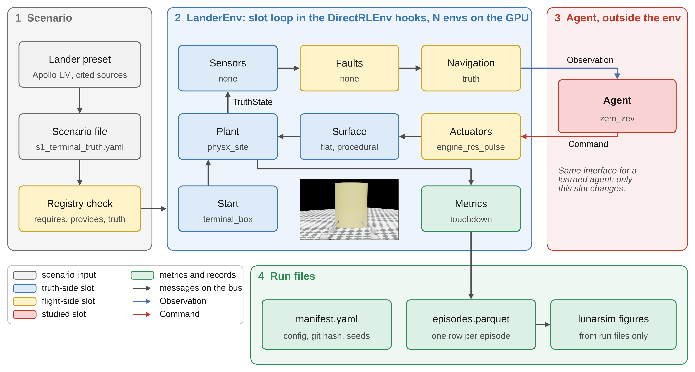
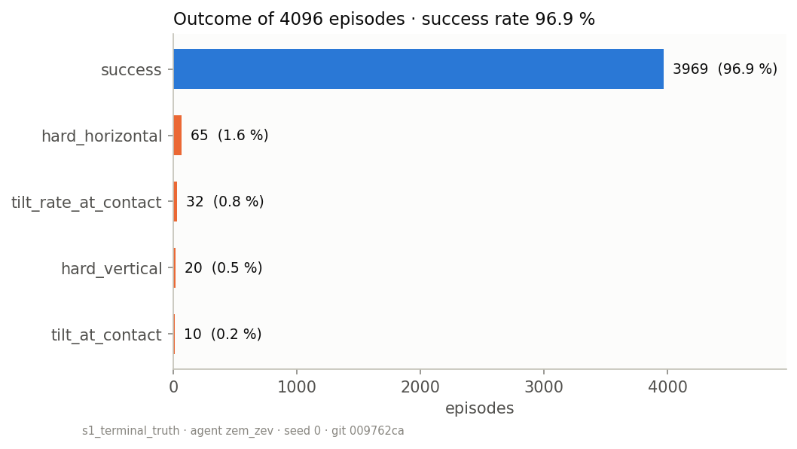
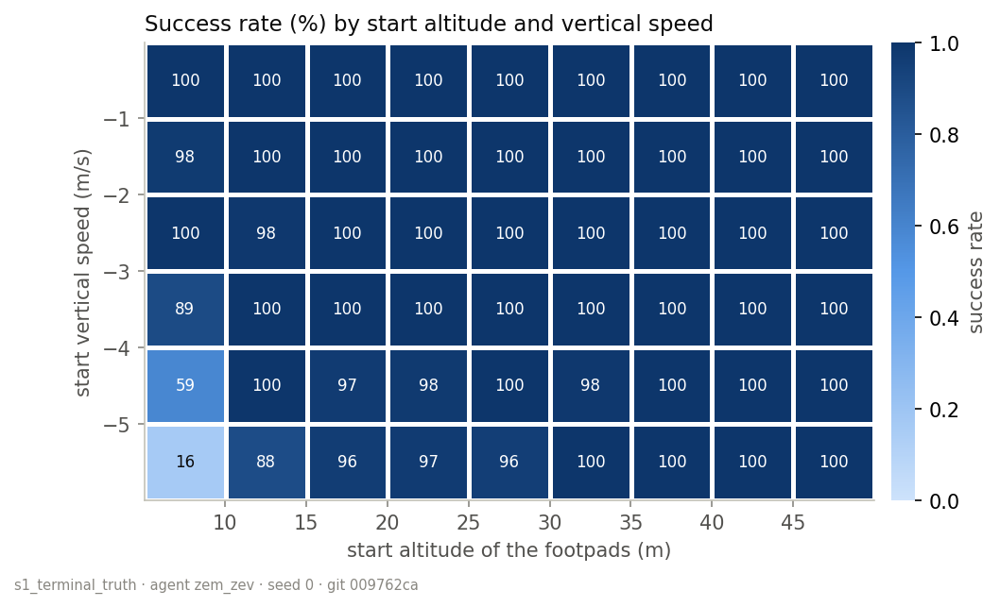
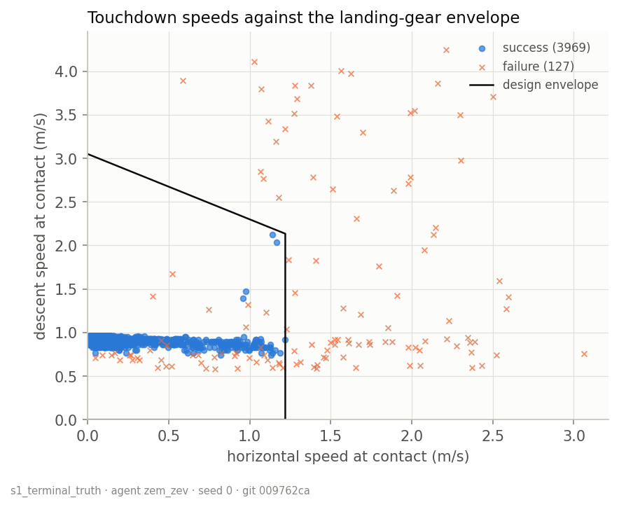
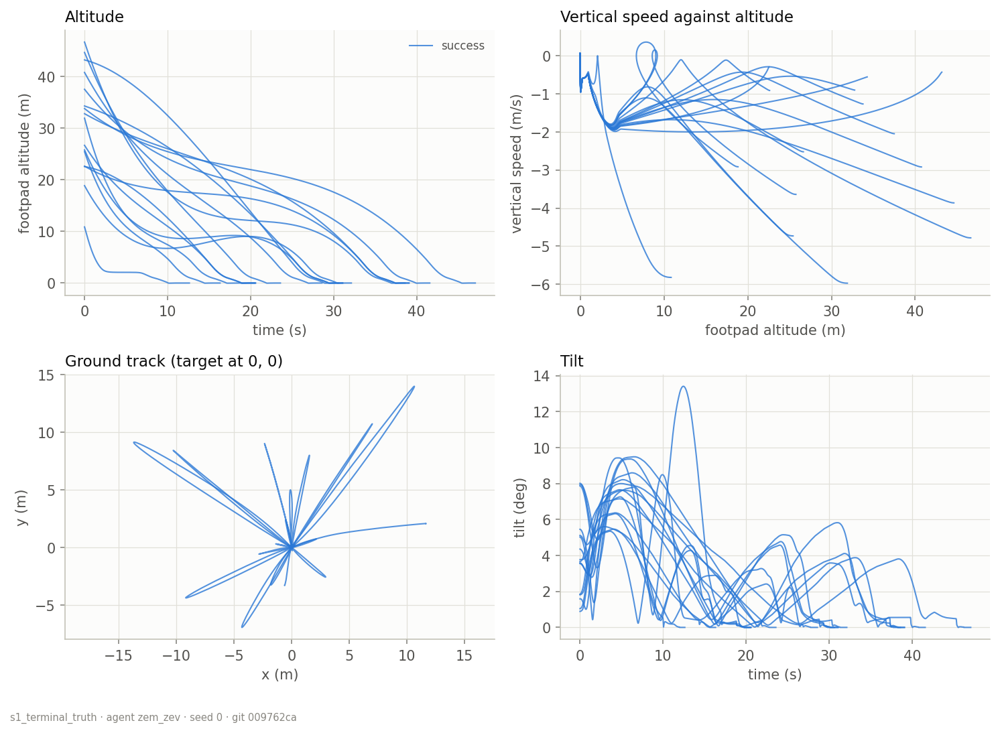

# M1A_REPORT: Milestone 0 (Skeleton) and Milestone 1a (Lander and classical S1)

Date: 2026-11-14. Machine: RTX 5060 (8 GB), Isaac Sim 6.0.1, Isaac Lab 3.0.0 `develop@e86463d`, PhysX.

**Result: both gates are passed.** The slot loop runs 1,024 environments; all physics validation
tests pass; the classical ZEM/ZEV agent lands 100 % of nominal starts and 96.8 % of the full
`terminal_box` range; the speed baseline is measured. No RL code exists in the repo.

## 1. What was built

| Area | Files |
| --- | --- |
| Core (torch only, no Isaac) | `src/lunarsim/core/`: `message_types.py`, `binding.py`, `message_bus.py`, `registry.py`, `random_generators.py`, `simulation_clock.py`, `frames.py` (stub), `rotation_math.py`, `physical_constants.py` |
| Environment | `src/lunarsim/env/`: `lander_env.py` (`DirectRLEnv`, slots in hook order), `lander_env_cfg.py`, `scenario_loader.py` (Hydra) |
| Slot bindings | `start`: `fixed`, `terminal_box` · `plant`: `rigid_box`, `physx_site` · `surface`: `flat`, `procedural` · `sensors`: `none` · `faults`: `none` · `nav`: `truth` · `actuators`: `none`, `engine_rcs_pulse` · `metrics`: `none`, `touchdown` |
| Lander | `configs/landers/apollo_lunar_module.yaml` (35 numbers, each with its source), `assets/lander_preset.py`, `assets/lander_builder.py` (USD text: body, 4 legs, 4 prismatic spring-damper struts) |
| Agents (outside the env) | `agents/classical/`: `attitude_controller.py`, `jet_selection.py`, `vertical_controller.py`, `zero_effort_guidance.py`; agents `zero`, `attitude_hold`, `hover_hold`, `vertical_descent`, `zem_zev` |
| Tools | `tools/`: `run_manifest.py`, `episode_records.py`, `trajectory_log.py`, `episode_runner.py`, `figures.py`, `failure_analysis.py`, `command_line.py` (`lunarsim figures`, `lunarsim summary`) |
| Scripts | `run_scenario.py`, `evaluate_agent.py`, `benchmark_environment.py`, `run_isaac_tests.py`, `render_lander_image.py` |
| Scenarios | `configs/scenarios/m0_null_loop.yaml`, `s1_terminal_truth.yaml` (`agent: zem_zev`) |
| Tests | 84 CPU tests in `tests/unit` (17 files); 12 GPU test files in `tests/physics` and `tests/smoke` |

Interface for M1b: the environment takes a flat action tensor of 19 values (throttle, 2 gimbal
angles, 16 jets) and returns `{"policy": (N, 14)}` built from `NavEstimate`. The classical agents
use exactly this interface, so M1b only adds an agent.

## 2. Physics validation (goal G2)

All tests state their tolerance and the reason in their docstring.

| Test | Known answer | Tolerance | Result |
| --- | --- | --- | --- |
| Free fall (GPU) | z = z0 − ½ g t², g = GM/R² = 1.6242 m/s² | 2 cm after 2 s against the exact formula; 1 mm against the integrator's own closed form; 1 mm/s in speed | Pass. 8.1 mm below the parabola (semi-implicit Euler, ½ g t dt); 0.1 mm from the integrator form; 0.1 mm/s |
| Hover (GPU) | thrust = m g holds altitude while mass drops | drift < 2 cm and < 5 mm/s over 20 s; mass drop within 0.1 % of ∫F/(Isp g0); control case rises by g ṁ t³/(6 m0) within 5 % | Pass |
| RCS torque (GPU) | ω = τ t / I per axis | 0.5 % on the fired axis; cross-axis below 0.5 %; no net force | Pass, both signs of all three axes |
| Propellant (CPU) | ṁ = F/(Isp g0); Δv = Isp g0 ln(m0/m1) | 1e-6 (flow), 1e-4 (Δv over a 60 s burn) | Pass |
| Actuator timing (CPU) | first-order lag reaches 63.2 % after one time constant; slew 85 %/s; pulse impulse = commanded on-time; 7 ms valve delay | 0.5 % of the step; 1e-7 s | Pass |
| Contact rest (GPU) | lander settles; Σ leg forces = m g | Σ within 0.5 %; each leg within 3 % (symmetric cases); strut compression within 2 % of the spring law; drift < 1 mm in 4 s; no contact loss after first contact | Pass in all 64 cases (1 m/s drop, 3 m/s drop, 2.1 m/s + 1.2 m/s sideways, 2.1 m/s at 6° tilt) |
| Articulation (GPU) | 5 links, 4 prismatic joints, mass and inertia from the preset; solver settings reach the stage | 1e-4 | Pass |

Two findings from these tests changed the model:

- **Centre of mass.** The RCS torque test showed a sideways drift. The legs had moved the vehicle
  centre of mass 9.5 cm below the body origin. Now the origin is the whole-vehicle centre of mass,
  as in the Apollo mass table, and forces act there.
- **Strut stiffness.** With the default TGS solver the struts were 22 % too soft at rest. See below.

## 3. Contact settings

| Setting | Value | Why |
| --- | --- | --- |
| Solver | **PGS** (`solver_type: 0`) | TGS left a steady error in the strut spring: its implicit joint damper acts on the light leg link (55 kg), so the effective stiffness was k/(1 + c·dt/(n·m_leg)) = 0.78 k at 8 iterations. PGS gives 0.998 k |
| Position / velocity iterations | 16 / 1 | 8 gave 0.964 k; 32 gave 1.000 k but 11 % slower |
| Physics step, control step | 5 ms, 20 ms | 2.5 ms was not better and half as fast |
| Contact offset, rest offset | 0.02 m, 0 m | no effect on the results in the range tested |
| Max depenetration velocity | 1 m/s | default choice; not tuned |
| Body damping (linear, angular) | 0, 0 | vacuum |
| Footpad friction, restitution | 0.4, 0 | NASA TN D-6850: 0.4 "a realistic value" after flight |
| Strut | k = 78.8 kN/m, damping ratio 1.0 (c = 24.0 kN s/m), stroke 0.813 m | linear stand-in for the crushable honeycomb; ratio 0.5 bounced in 222 of 512 drops |

Study with 512 landers (0.5–3 m/s vertical, 0–1.2 m/s horizontal, ±6° tilt): no bounce, no
tip-over, largest strut stroke 0.25 m, leg forces sum to 1.0000 m g. After settling, the position
changes by less than 0.25 mm in 10 s. A solver vibration of about 10 µm stays in the struts; it
shows as up to 5 mm/s of velocity noise in about 10 % of the landers.

## 4. Controller, step by step

| Step | Agent | Test | Result |
| --- | --- | --- | --- |
| 1 Attitude hold | `attitude_hold` | start tilts 1–10°, hover thrust, 20 s | upright after 12 s; residual tilt 0.39°; rate < 0.3 °/s; jet propellant 0.13–1.16 kg (a first version without a rate dead band chattered and burned 6 kg) |
| 2 Hover | `hover_hold` | hold 30 m for 60 s from 27–33 m, −2…+1 m/s, tilt ≤ 5° | altitude error 0.6 mm, speed 0.3 mm/s (15–60 s), while 240 kg burn |
| 3 Vertical descent | `vertical_descent` | 16 starts, 5–50 m, 0…−2 m/s, straight above | 16 of 16 land; contact at 0.95–0.99 m/s; 20–59 kg; 7–16 s |
| 4 Full ZEM/ZEV | `zem_zev` | 256 nominal starts (20–50 m, −3…0 m/s, ±2 m/s per horizontal axis, tilt ≤ 10°) | 256 of 256 land; contact 0.89–0.95 m/s down, ≤ 0.39 m/s sideways, tilt ≤ 0.59°; miss 0.22 m mean, 1.05 m max; 71–215 kg |

How `zem_zev` works: ZEM/ZEV guidance flies to a gate 3 m above the target; the time-to-go is
the shortest one whose plan respects thrust and tilt limits, stretched by 25 % plus 2 s. Lateral
acceleration comes from tilting the lander with the RCS attitude loop. Then the vertical loop
follows a descent-rate profile; it waits above the ground while the horizontal speed is above
0.3–1.0 m/s, holds the lander upright below 2 m, and cuts the engine at 0.25 m.

## 5. ZEM/ZEV over the full `terminal_box` range

Start range (S1): altitude 5–50 m, vertical speed −6…0 m/s, each horizontal component ±2 m/s,
tilt 0–10°. Three seeds, 4,096 episodes each, one episode per environment. Success means: inside
the Apollo landing-gear envelope at contact (TN D-6850: ≤ 3.05 m/s vertical, ≤ 1.22 m/s
horizontal with the linear cut above 2.13 m/s, tilt ≤ 6°, rate ≤ 2 °/s), then settled and upright.

| Seed | Success | hard_horizontal | tilt_rate_at_contact | hard_vertical | tilt_at_contact |
| --- | --- | --- | --- | --- | --- |
| 0 | 96.90 % (3,969) | 65 | 32 | 20 | 10 |
| 1 | 96.51 % (3,953) | 78 | 39 | 21 | 5 |
| 2 | 96.90 % (3,969) | 73 | 28 | 20 | 6 |
| **All** | **96.77 % ± 0.23** (11,891 of 12,288) | 216 | 99 | 61 | 21 |

No tip-over, no time-out, no propellant depletion (largest use 215 kg of 306 kg usable).

**Failures grouped by cause (397 episodes):**

| Group | Episodes | Outcomes | Explanation |
| --- | --- | --- | --- |
| Low and fast start (below 20 m with more than 3 m/s descent) | 349 (88 %) | 197 hard_horizontal, 70 tilt_rate, 61 hard_vertical, 21 tilt | Stopping the descent takes most of the thrust and of the time. Max net deceleration is 2.5 m/s², and the throttle slews at 85 %/s, so 5–10 m is used up for braking alone. A few seconds remain to remove up to 2.8 m/s of horizontal speed and up to 10° of tilt with 0.1 rad/s² of RCS authority |
| Other | 48 (12 %, 0.39 % of all) | 29 tilt_rate, 19 hard_horizontal | Starts up to 35 m, mostly fast descents just outside the group above. Not analysed further; see open issues |
| Impossible start (ideal lander at full thrust still exceeds 3.05 m/s) | 0 | — | The ideal bound (no lag, upright) is at most 2.91 m/s in this box, so no start is strictly impossible. All 61 hard_vertical cases are therefore controller-and-actuator limited, not physically impossible |

Success by region: **99.53 %** (10,112 of 10,160) for starts at or above 20 m or slower than
3 m/s; **83.6 %** for starts below 20 m and faster than 3 m/s (56 % in 5–10 m, 96 % in 10–15 m,
98 % in 15–20 m).

Successful landings (11,891): contact at 0.92 m/s down (median; fastest 2.29), 0.08 m/s sideways
(median; 95 % below 0.37), tilt 0.39° (median), propellant 114 kg (median), 28 s (median). Landing
miss: 0.26 m median, 9.4 m at the 95th percentile, 42.6 m worst. The final descent removes speed
but does not steer position, so cut-short guided phases miss the target.

Figures are from `runs/m1a_zem_zev_full_box_seed0` (git-ignored; rebuild with
`python scripts/evaluate_agent.py scenario=s1_terminal_truth num_envs=4096 seed=0 run_name=...`
and `lunarsim figures <run_dir>`).

## 6. Speed and memory (goal G4 baseline)

S1 with `zem_zev`, 500 control steps after warm-up, RTX 5060. "Env steps" are control steps
(20 ms, 4 PhysX steps each) times environments, agent included.

| Environments | Env steps / s | PhysX steps / s | GPU memory of the process |
| --- | --- | --- | --- |
| 64 | 5,785 | 23,141 | 2.33 GB |
| 256 | 21,433 | 85,733 | 2.33 GB |
| 1,024 | 69,646 | 278,583 | 2.46 GB |
| 4,096 | 159,733 | 638,934 | 2.99 GB |
| 8,192 | 190,096 | 760,384 | 3.70 GB |
| 16,384 | 203,702 | 814,808 | 5.07 GB |

Throughput flattens above 8,192 environments. Below 1,024 the Python overhead per step dominates.
The null loop of milestone 0 (a box, 1,024 envs) runs at about 151,000 env steps/s.

## 7. Deviations from the design and the plan (all also in PROGRESS.md)

1. `set_external_force_and_torque` is deprecated in this Isaac Lab; the plant writes the
   permanent wrench composer every substep (agreed).
2. The plant state is read in hook 3 and again in hook 6 (agreed).
3. `Wrench` has one extra field, `mass_flow_rate`, and the start slot hands its sample to the
   plant in a `start_state` message. Both were needed because the design interface gives
   `reset()` no bus and the plant must know the propellant flow.
4. Truth access: start, plant, surface, sensors and metrics may set `reads_truth`; faults,
   navigation other than `truth`, agent and actuators may not. The design text names only
   `nav: truth` and metrics, but its diagram feeds `TruthState` to sensors and surface.
5. PGS solver instead of the default TGS (section 3).
6. Package path is `src/lunarsim` and the build backend is setuptools (template uses `uv_build`; `uv` is not installed).
7. `surface: procedural` is smoke-tested only. The agents assume the ground at z = 0.

## 8. Open issues

- **CI is not on GitHub.** The `gh` token has no `workflow` scope, so the push of
  `.github/workflows/cpu_tests.yml` is rejected. The file waits untracked. Fix:
  `gh auth refresh -h github.com -s workflow`, then commit and push it.
- **Strut model.** A linear spring-damper along the body axis replaces inclined struts with
  crushable honeycomb. Peak leg forces (19–71 kN in successful landings) exceed the real crush
  loads (20 and 42 kN), so leg loads are not yet realistic. Touchdown speeds and tilt are not affected.
- **Velocity noise at rest** of up to 5 mm/s from a 10 µm strut vibration. Harmless for
  touchdown metrics; it will matter for the IMU model in M2.
- **One assumed number in the preset:** the height of the RCS clusters above the centre of mass
  (1.03 m). No fetched primary source gives it. It only changes cross-coupling of horizontal jets.
- **Engine model:** the fixed throttle point (92.5 %) and the gimbal are not modelled; a throttle
  command below 5 % shuts the engine down (model choice). RCS propellant is not limited.
- **Mass in PhysX** is updated once per control step, and inertia is scaled with mass.
- **48 unexplained failures (0.39 %)** outside the low-and-fast group; and landing miss up to
  43 m when the guided phase is cut short.
- **Start mass** is the Apollo 11 touchdown mass (7,327 kg) with the 306 kg of usable propellant
  that remained at cutoff. A start with more propellant needs a sourced number.
- **Simulator exit.** The Isaac process once failed to exit after a finished test; the test
  runner now judges by the pytest summary and stops such a process.
- Isaac Lab 3.0 is a development branch; an upgrade may change the API.

## 9. Task list for M1b (RL on S1)

1. Add `agents/rsl_rl/` with a `ppo_mlp` agent binding and the rsl_rl vector-env wrapper around `LanderEnv` (register a gym id).
2. Reward terms from the scenario file (`reward:` section) computed in `_get_rewards` from the metrics slot output; no other env change.
3. Decide the action mapping for learning: 16 jet duties, or 3 axis commands through `JetCoupleTable`; decide observation scaling. Both live in the agent adapter, not in the env.
4. Critic observation group with `TruthState` through the logged path (also needed for M2).
5. Train and evaluate scripts; 5 seeds; held-out start states through `TerminalBoxStart.set_fixed_start_states`.
6. PPO against `zem_zev` on the same held-out starts, reported with `lunarsim summary` and the same figures. Report the low-and-fast region separately.
7. Truth-leak check and smoke test for the new binding; speed log with the policy in the loop.
8. Before training: fix the CI token scope so CPU tests run on every push.

## 10. Addendum, 2026-11-15: corrections found after the gate

Work on the real terrain found four errors in the milestone 1a lander and environment. All are
fixed, with tests, and the full-range evaluation was repeated (details in
`docs/knowledge/terrain-results.md` and `docs/knowledge/decisions-log.md`):

1. **RCS torque arms 29 % too short.** Cox's "arm 5.5 ft" was read as the distance from the axis
   on the diagonal; MIT R-567 gives 1.679 m along each body axis.
2. **Forces applied 0.1 m above the vehicle c.g.** Isaac Lab's wrench composer measures the
   application point from the body's own centre of mass, not from the link origin.
3. **Iyy** 13,667 slug ft² was a text-extraction error; the page says 13,867.
4. **Footpad friction 0.2, not 0.4.** The lander had no material; PhysX combined Isaac Lab's
   default 0.5 with the ground's 0.4 by multiplying.

With the corrected lander (and dish footpads, c.g. offset and stage shapes added) ZEM/ZEV lands
**97.53 % ± 0.12** of the full range on flat ground (was 96.77 %), and every failure now starts
low and fast: the 48 unexplained failures of section 5 are gone. On the Apollo 17 terrain with
craters and rocks it lands 96.78 % ± 0.25. The observation has 15 values since this change.

