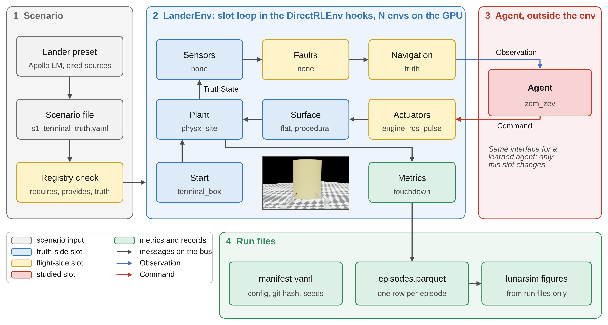

# LunarSim v2

A modular lunar-landing research simulator on Isaac Lab, written from scratch.
Every part of the control loop is a *slot* with typed inputs and outputs, so a study can swap
sensors, faults, estimators, agents or physics in one line of a scenario file.



**The slot loop of LunarSim v2 as built in milestone 1a.** (1) A scenario file names one
binding per slot and a lander preset; the registry check stops the run if a required message
has no provider or a flight-side binding would read the true state. (2) `LanderEnv` runs the
eight environment slots inside the `DirectRLEnv` hooks for N environments on the GPU: start,
plant, sensors, faults and navigation produce the estimate; actuators and surface turn the
command into a wrench on the plant; metrics judge the touchdown. Blue slots belong to the
simulated world and may read `TruthState`; yellow slots are flight software and may not,
except `nav: truth`. (3) The agent sits outside the environment and exchanges only
`Observation` and `Command`; here it is the classical ZEM/ZEV baseline. (4) Every run writes a
manifest and one record per episode, and figures are made from these files alone.


*The Apollo LM preset at rest on flat ground (collision shapes of the simulator).*

- Design: [docs/design](docs/design) (architecture and build plan, scenario catalogue).
- Plan for the current milestones: [PLAN.md](PLAN.md). Status: [PROGRESS.md](PROGRESS.md).

## Pinned versions

| Component | Version |
| --- | --- |
| Isaac Sim | 6.0.1 (pip) |
| Isaac Lab | 3.0.0, branch `develop`, commit `e86463d` |
| Physics backend | PhysX (selected explicitly) |
| Python | 3.12 |
| torch | 2.11.0 |

## Install

```bash
# inside the Python environment that has Isaac Sim and Isaac Lab
pip install -e ".[dev]"
```

The `lunarsim.core` package and the pure-torch models need only `torch`, so the CPU tests run
without Isaac:

```bash
pytest tests/unit
```

Tests that need Isaac Lab and a GPU each start their own simulator process:

```bash
python scripts/run_isaac_tests.py            # all GPU tests
python scripts/run_isaac_tests.py smoke      # one folder
```

## Run a scenario

```bash
python scripts/run_scenario.py scenario=m0_null_loop num_envs=1024 steps=100
```

## Layout

```
src/lunarsim/core       message types, bus, registry, clock, random generators, frames
src/lunarsim/slots      one folder per slot, one file per binding
src/lunarsim/env        LanderEnv (DirectRLEnv), config, scenario loader
src/lunarsim/agents     classical agents (learning agents come in milestone 1b)
src/lunarsim/assets     lander builder from a preset
src/lunarsim/tools      run manifest, episode records, figures
configs/scenarios       one Hydra file per scenario
configs/landers         lander presets, every number with its public source
tests/unit              CPU tests (run on every push)
tests/physics, smoke    GPU tests (need Isaac Lab)
```

## License

BSD-3-Clause. See [LICENSE](LICENSE).
