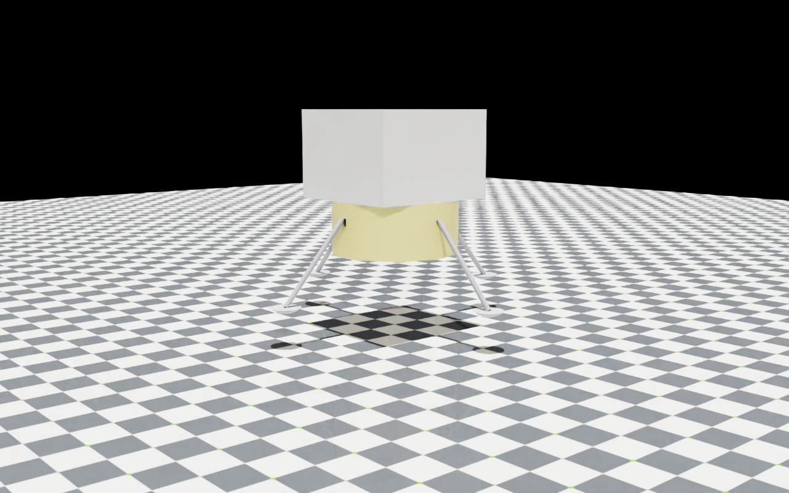
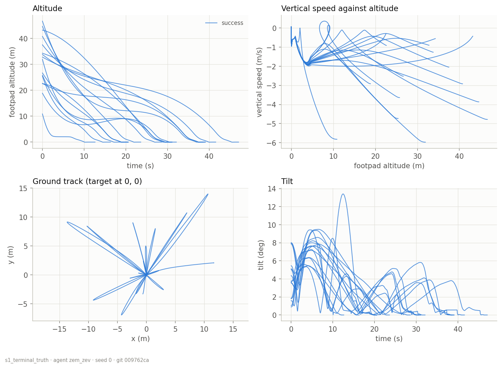
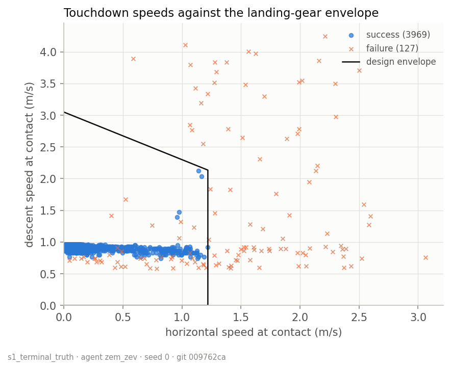
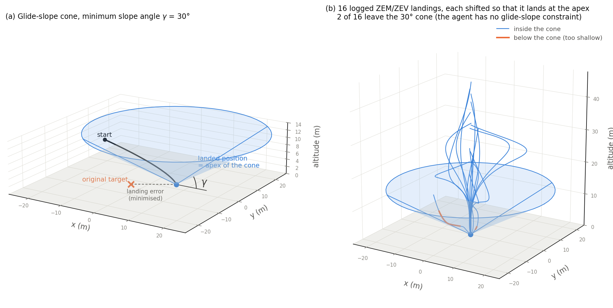

# LunarSim v2

A modular lunar-landing research simulator on Isaac Lab, written from scratch.
Every part of the control loop is a *slot* with typed inputs and outputs, so a study can swap
sensors, faults, estimators, agents or physics in one line of a scenario file.


**The slot loop of LunarSim v2 as built in milestone 1a.** (1) A scenario file names one
binding per slot and a lander preset; the registry check stops the run if a required message
has no provider or a flight-side binding would read the true state. (2) `LanderEnv` runs the
eight environment slots inside the `DirectRLEnv` hooks for N environments on the GPU: start,
plant, sensors, faults and navigation produce the estimate; actuators and surface turn the
command into a wrench on the plant; metrics judge the touchdown. Blue slots belong to the
simulated world and may read `TruthState`; yellow slots are flight software and may not,
except `nav: truth`. (3) The agent sits outside the environment and exchanges only
`Observation` and `Command`; here it is the classical ZEM/ZEV baseline. (4) Every run writes a
manifest and one record per episode, and figures are made from these files alone.



*The Apollo LM preset at rest on flat ground (collision shapes of the simulator).*

## Results of milestone 1a

The classical ZEM/ZEV agent on scenario S1 (true state, flat ground, Apollo LM preset). Full
numbers, tolerances and open issues are in [M1A_REPORT.md](M1A_REPORT.md).


*Success rate over the full `terminal_box` start range (seed 0, 4,096 episodes). Over three
seeds the rate is 96.8 %; almost all failures start below 20 m with more than 3 m/s of descent
rate.*



*Sixteen logged landings: altitude, vertical speed against altitude, ground track and tilt.*



*Speeds at first footpad contact against the landing-gear design envelope of the preset.*



*The glide-slope constraint of powered-descent guidance. (a) The lander must stay inside a cone
with minimum slope angle γ; in the minimum-landing-error problem the apex is the landed
position, not the original target. (b) The same sixteen landings, each shifted so that it lands
at the apex of a 30° cone. Two of them leave the cone (orange): the ZEM/ZEV agent has no
glide-slope constraint.*

- Design: [docs/design](docs/design) (architecture and build plan, scenario catalogue).
- Plan for the current milestones: [PLAN.md](PLAN.md). Status: [PROGRESS.md](PROGRESS.md).

## Pinned versions

| Component | Version |
| --- | --- |
| Isaac Sim | 6.0.1 (pip) |
| Isaac Lab | 3.0.0, branch `develop`, commit `e86463d` |
| Physics backend | PhysX (selected explicitly) |
| Python | 3.12 |
| torch | 2.11.0 |

## Install

On a new machine, `scripts/setup_workstation.sh` builds the whole environment (Isaac Sim, Isaac Lab at the
pinned commit, torch, this package) and `python scripts/check_installation.py` compares it with the pinned
versions. It has been tested only as a check on the development machine, not yet on a clean one.

To install only this package into an existing Isaac Lab environment:

```bash
# inside the Python environment that has Isaac Sim and Isaac Lab
pip install -e ".[dev]"
```

The `lunarsim.core` package and the pure-torch models need only `torch`, so the CPU tests run
without Isaac:

```bash
pytest tests/unit
```

Tests that need Isaac Lab and a GPU each start their own simulator process:

```bash
python scripts/run_isaac_tests.py            # all GPU tests
python scripts/run_isaac_tests.py smoke      # one folder
```

## Run a scenario

```bash
python scripts/run_scenario.py scenario=m0_null_loop num_envs=1024 steps=100
```

## Layout

```
src/lunarsim/core       message types, bus, registry, clock, random generators, frames
src/lunarsim/slots      one folder per slot, one file per binding
src/lunarsim/env        LanderEnv (DirectRLEnv), config, scenario loader
src/lunarsim/agents     classical agents (learning agents come in milestone 1b)
src/lunarsim/assets     lander builder from a preset
src/lunarsim/tools      run manifest, episode records, figures
configs/scenarios       one Hydra file per scenario
configs/landers         lander presets, every number with its public source
tests/unit              CPU tests (run on every push)
tests/physics, smoke    GPU tests (need Isaac Lab)
docs/knowledge          project knowledge graph: rules, decisions, results, plans, open questions
```

New to the project, or on a new machine? Start at [docs/knowledge/README.md](docs/knowledge/README.md).

## License

BSD-3-Clause. See [LICENSE](LICENSE).
