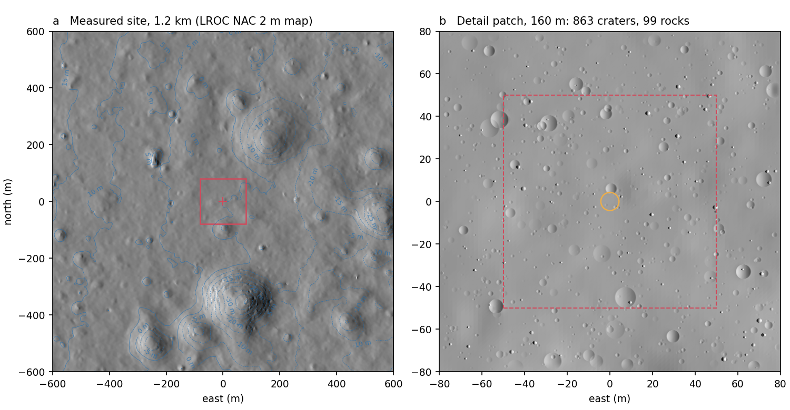
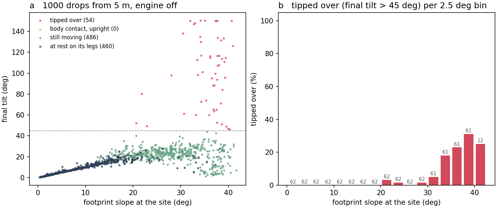
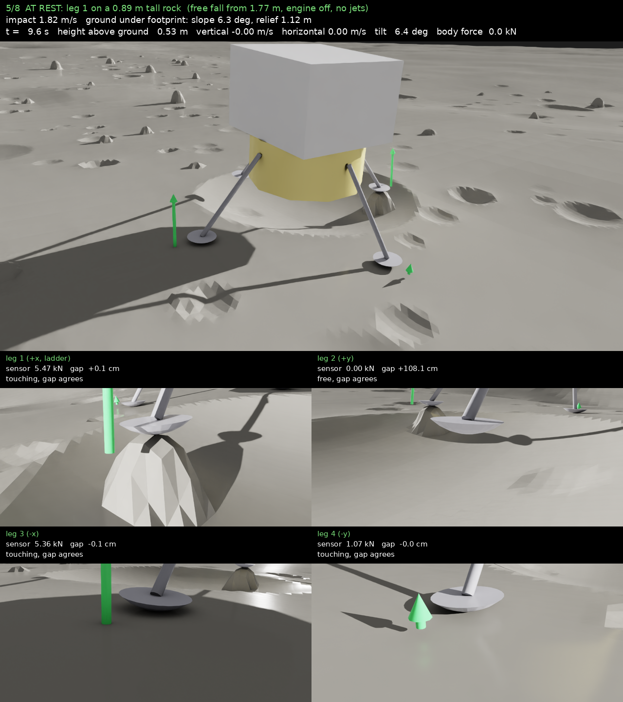
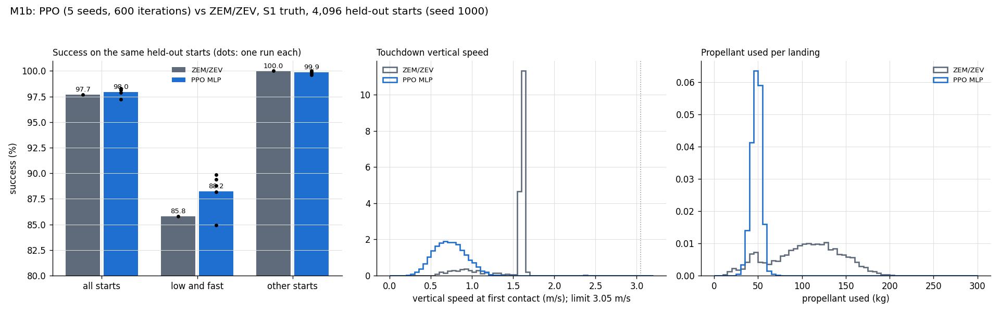
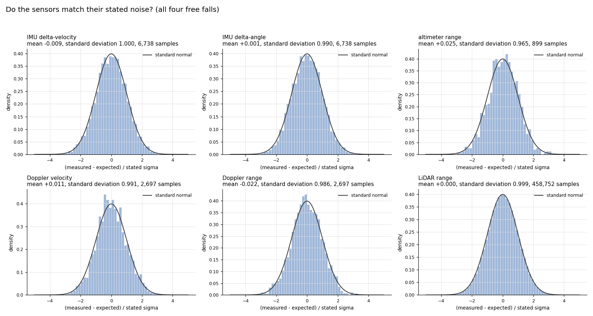
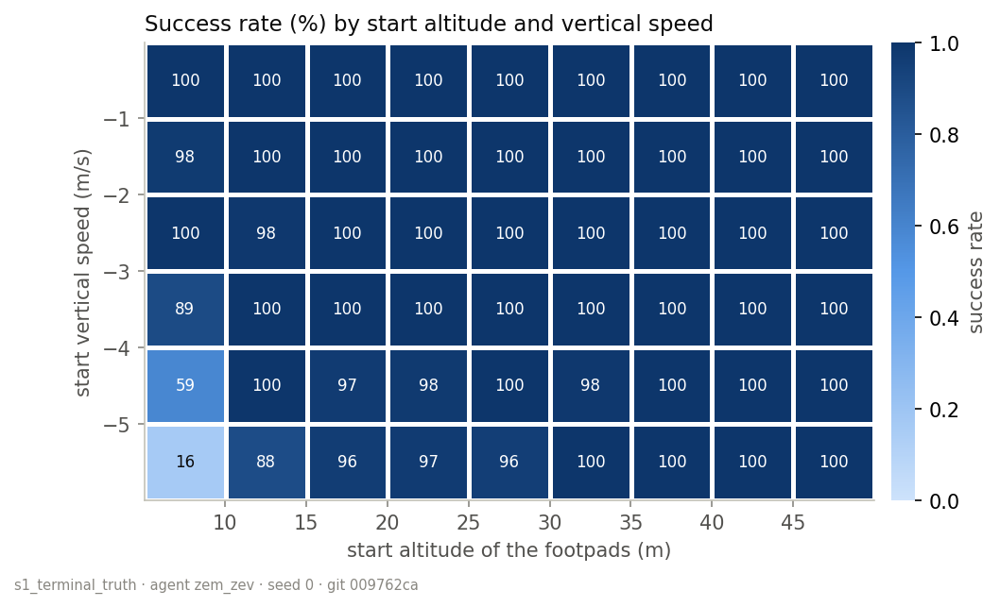

# LunarSim v2

A modular lunar-landing research simulator on Isaac Lab, written from scratch.
Every part of the control loop is a *slot* with typed inputs and outputs, so a study can swap
sensors, faults, estimators, agents or physics in one line of a scenario file.


**The slot loop of LunarSim v2 as built up to milestone 3.** (1) A scenario file (here the
sensor-failure study `s3_faults`) names one binding per slot and a lander preset; the registry
check stops the run if a required message has no provider or a flight-side binding would read
the true state. (2) `LanderEnv` runs the eight environment slots inside the `DirectRLEnv` hooks
for N environments on the GPU. Start puts each lander in its start box with a navigation error;
the sensor suite (IMU, radar altimeter, Doppler velocimeter, optional flash LiDAR, propellant
gauge, contact probes) reads the true state; faults corrupt or delay the readings; the filter
(`ekf`, `ekf_fdi` with failure detection, or `ekf_late_fusion`) makes the estimate. Actuators
and surface (flat ground or the measured Apollo 17 terrain) turn the command into a wrench on
the plant; metrics judge the touchdown and the response to each fault. Blue slots belong to the
simulated world and may read `TruthState`; yellow slots are flight software and may not.
(3) The agent sits outside the environment and exchanges only `Observation` and `Command`: the
classical ZEM/ZEV baseline or a PPO policy (`ppo_mlp`, `ppo_gru`, `ppo_attention`) trained with
rsl_rl. (4) Every run writes a manifest and one record per episode, and figures and comparisons
are made from these files alone.


*The Apollo LM preset at rest on flat ground (collision shapes of the simulator): a cylinder for
the descent stage, a box for the ascent stage, dish footpads on spring-damper struts. The three
surface probes and the nozzle have no collision shape and are not drawn.*

## Real terrain: Apollo 17 with craters and rocks

The surface `measured_terrain` puts every environment on its own landing target at the Apollo 17
site: the measured 2 m LROC NAC height map (1.2 km), plus a 160 m patch with small craters and
rocks drawn from published statistics. The lander matches the Apollo LM: dish footpads
(0.94 m × 0.18 m), centre-of-mass offset, descent and ascent stage shapes, nozzle clearance
and the RCS jet positions of MIT R-567. Details: [docs/knowledge/measured-terrain-surface.md](docs/knowledge/measured-terrain-surface.md).

The height maps are public and **not in git**. Get them once per machine (952 MB):

```bash
python scripts/download_height_maps.py
python scripts/evaluate_agent.py scenario=apollo17_terminal_truth num_envs=4096 run_name=apollo17_seed0
```



*(a) The measured site around the Apollo 17 lunar module (+), with 5 m contours; red: the
detail patch. (b) The detail patch with the drawn craters and rocks (seed 0); dashed: landing
targets are drawn in this square; yellow: the 4.26 m LM footprint.*

| ZEM/ZEV, 3 seeds × 4,096 episodes | Success |
| --- | --- |
| Flat ground, milestone 1a lander | 96.77 % ± 0.23 |
| Flat ground, LM-accurate lander | 97.53 % ± 0.12 |
| Apollo 17 terrain with craters and rocks | 96.78 % ± 0.25 |

On terrain, 27 of 12,288 landings fail because a stage hits a rock. Full numbers:
[docs/knowledge/terrain-results.md](docs/knowledge/terrain-results.md).



*1,000 free-fall drops from 5 m (no engine, no jets, no control) on a steep part of the same
height map. (a) Final tilt against the slope under the footprint. (b) Share of landers that end
on their side (final tilt above 45°) per slope bin. Below 20° no lander tips; above 22°
(friction 0.4) most slide, and from 30° on many roll over. Details:
[docs/knowledge/drop-test-results.md](docs/knowledge/drop-test-results.md).*

### Footpad contact check

Eight landers fall freely onto chosen ground (flat, steep, crater, crater rim, rocks) and come to
rest. For every footpad the contact-sensor force is compared with the gap between the dish and
the ground: all 32 agree (loaded pads within ±0.4 cm, free pads 15–108 cm clear). Green arrows:
sensor force, 1 m per 3 kN. Run `python scripts/contact_check.py`, then
`python scripts/render_replay.py replay=runs/contact_check/contacts.npz mode=stills`.



*Leg 1 rests on a 0.89 m rock (5.47 kN, gap +0.1 cm); leg 2 hangs 1.08 m above a dip with no
force. All stills and the table: [docs/contact_check](docs/contact_check),
[docs/knowledge/contact-check-results.md](docs/knowledge/contact-check-results.md).*

## Status (2026-11-15)

| Milestone | Status |
| --- | --- |
| M0 slot loop, M1a lander and ZEM/ZEV | gates passed |
| M1b PPO on S1 | **gate passed**: PPO 97.95 % ± 0.44 (5 seeds) vs ZEM/ZEV 97.68 % on the same held-out starts |
| M2 sensors and EKF | **gate passed**: NEES 9.78 on recorded truth; S2 and a visual sensor check |
| M3 faults and memory agents | built; paper 1 training running |





Details and every number with its source: `docs/knowledge/README.md`.

## Results of milestone 1a

The classical ZEM/ZEV agent on scenario S1 (true state, flat ground, Apollo LM preset). Full
numbers, tolerances and open issues are in [M1A_REPORT.md](M1A_REPORT.md). These figures were
made with the milestone 1a lander, before the corrections of 2026-11-15 (see above).



*Success rate over the full `terminal_box` start range (seed 0, 4,096 episodes). Over three
seeds the rate is 96.8 %; almost all failures start below 20 m with more than 3 m/s of descent
rate.*


*Sixteen logged landings: altitude, vertical speed against altitude, ground track and tilt.*


*Speeds at first footpad contact against the landing-gear design envelope of the preset.*


*The glide-slope constraint of powered-descent guidance. (a) The lander must stay inside a cone
with minimum slope angle γ; in the minimum-landing-error problem the apex is the landed
position, not the original target. (b) The same sixteen landings, each shifted so that it lands
at the apex of a 30° cone. Two of them leave the cone (orange): the ZEM/ZEV agent has no
glide-slope constraint.*

- Design: [docs/design](docs/design) (architecture and build plan, scenario catalogue).
- Plan for the current milestones: [PLAN.md](PLAN.md). Status: [PROGRESS.md](PROGRESS.md).

## Pinned versions

| Component | Version |
| --- | --- |
| Isaac Sim | 6.0.1 (pip) |
| Isaac Lab | 3.0.0, branch `develop`, commit `e86463d` |
| Physics backend | PhysX (selected explicitly) |
| Python | 3.12 |
| torch | 2.11.0 |

## Install

On a new machine, `scripts/setup_workstation.sh` builds the whole environment (Isaac Sim, Isaac Lab at the
pinned commit, torch, this package) and `python scripts/check_installation.py` compares it with the pinned
versions. It has been tested only as a check on the development machine, not yet on a clean one.

To install only this package into an existing Isaac Lab environment:

```bash
# inside the Python environment that has Isaac Sim and Isaac Lab
pip install -e ".[dev]"
```

The `lunarsim.core` package and the pure-torch models need only `torch`, so the CPU tests run
without Isaac:

```bash
pytest tests/unit
```

Tests that need Isaac Lab and a GPU each start their own simulator process:

```bash
python scripts/run_isaac_tests.py            # all GPU tests
python scripts/run_isaac_tests.py smoke      # one folder
```

## Run a scenario

```bash
python scripts/run_scenario.py scenario=m0_null_loop num_envs=1024 steps=100
```

## Layout

```
src/lunarsim/core       message types, bus, registry, clock, random generators, frames
src/lunarsim/slots      one folder per slot, one file per binding
src/lunarsim/env        LanderEnv (DirectRLEnv), config, scenario loader
src/lunarsim/agents     classical agents (learning agents come in milestone 1b)
src/lunarsim/assets     lander builder from a preset
src/lunarsim/tools      run manifest, episode records, figures
configs/scenarios       one Hydra file per scenario
configs/landers         lander presets, every number with its public source
tests/unit              CPU tests (run on every push)
tests/physics, smoke    GPU tests (need Isaac Lab)
docs/knowledge          project knowledge graph: rules, decisions, results, plans, open questions
```

New to the project, or on a new machine? Start at [docs/knowledge/README.md](docs/knowledge/README.md).

## License

BSD-3-Clause. See [LICENSE](LICENSE).
