# Knowledge graph overview

Generated by `lunarsim knowledge-graph`. Do not edit by hand.
Only named relations are drawn; `graph.json` also holds the plain mentions.

```mermaid
flowchart LR
  subgraph rule
    rules_from_the_user["Rules from the user"]
  end
  subgraph design
    project_goal_and_design_documents["Project goal and design documents"]
  end
  subgraph milestone
    milestone_roadmap_and_status["Milestone roadmap and status"]
  end
  subgraph component
    bindings_catalogue["Bindings catalogue"]
    classical_agents["Classical agents"]
    knowledge_graph_tooling["Knowledge graph tooling"]
    lander_articulation_model["Lander articulation model"]
    lander_preset_apollo_lm["Lander preset, Apollo LM"]
    measured_terrain_surface["Measured terrain surface (Apollo 17)"]
    metrics_and_run_records["Touchdown metric and run records"]
    physx_contact_settings["PhysX contact settings"]
    slot_loop_architecture["Slot loop architecture"]
  end
  subgraph decision
    decisions_log["Decisions log"]
  end
  subgraph result
    drop_test_results["Drop test on steep terrain"]
    milestone_1a_results["Milestone 1a results"]
    speed_benchmarks["Speed benchmarks"]
    terrain_results["Results with the LM-accurate lander and real terrain"]
  end
  subgraph issue
    open_issues["Open issues"]
  end
  subgraph plan
    pending_user_decisions["Pending user decisions"]
    terrain_integration_plan["Terrain integration plan"]
  end
  subgraph research
    apollo_lander_modeling_folder["The apollo_lander_modeling folder"]
    apollo_lm_geometry_research["Apollo LM geometry research"]
    apollo17_height_maps["Apollo 17 height maps (LROC NAC DTM)"]
    lunar_surface_statistics_research["Lunar surface statistics research"]
    sources_bibliography["Sources bibliography"]
  end
  subgraph environment
    isaac_lab_quirks["Isaac Lab quirks"]
    testing_and_commands["Testing and commands"]
    workstation_setup_and_machines["Workstation setup and machines"]
  end
  subgraph history
    session_history["Session history"]
  end
  apollo_lander_modeling_folder -- "source for" --> terrain_integration_plan
  apollo_lm_geometry_research -- "feeds" --> terrain_integration_plan
  apollo_lm_geometry_research -- "refines" --> lander_preset_apollo_lm
  apollo17_height_maps -- "used by" --> measured_terrain_surface
  apollo17_height_maps -- "first worked with in" --> apollo_lander_modeling_folder
  bindings_catalogue -- "part of" --> slot_loop_architecture
  bindings_catalogue -- "uses" --> lander_preset_apollo_lm
  classical_agents -- "flies on" --> slot_loop_architecture
  classical_agents -- "judged by" --> metrics_and_run_records
  drop_test_results -- "measured on" --> measured_terrain_surface
  drop_test_results -- "compares with" --> terrain_results
  isaac_lab_quirks -- "applies to" --> workstation_setup_and_machines
  knowledge_graph_tooling -- "required by" --> rules_from_the_user
  lander_articulation_model -- "built from" --> lander_preset_apollo_lm
  lander_articulation_model -- "simulated with" --> physx_contact_settings
  lander_preset_apollo_lm -- "sources" --> sources_bibliography
  lander_preset_apollo_lm -- "weak points" --> open_issues
  lunar_surface_statistics_research -- "feeds" --> terrain_integration_plan
  measured_terrain_surface -- "part of" --> bindings_catalogue
  measured_terrain_surface -- "data" --> apollo17_height_maps
  measured_terrain_surface -- "statistics" --> lunar_surface_statistics_research
  metrics_and_run_records -- "produces" --> milestone_1a_results
  metrics_and_run_records -- "commands" --> testing_and_commands
  milestone_1a_results -- "measured with" --> classical_agents
  milestone_1a_results -- "judged by" --> metrics_and_run_records
  milestone_1a_results -- "speed" --> speed_benchmarks
  milestone_roadmap_and_status -- "follows" --> project_goal_and_design_documents
  milestone_roadmap_and_status -- "built" --> measured_terrain_surface
  milestone_roadmap_and_status -- "history" --> session_history
  physx_contact_settings -- "used by" --> lander_articulation_model
  physx_contact_settings -- "recorded in" --> decisions_log
  project_goal_and_design_documents -- "governs" --> milestone_roadmap_and_status
  project_goal_and_design_documents -- "governs" --> slot_loop_architecture
  rules_from_the_user -- "design authority" --> project_goal_and_design_documents
  rules_from_the_user -- "design authority" --> decisions_log
  session_history -- "leads to" --> milestone_roadmap_and_status
  slot_loop_architecture -- "implements" --> project_goal_and_design_documents
  slot_loop_architecture -- "runs on" --> physx_contact_settings
  slot_loop_architecture -- "details in" --> bindings_catalogue
  sources_bibliography -- "cited by" --> lander_preset_apollo_lm
  sources_bibliography -- "cited by" --> apollo_lm_geometry_research
  sources_bibliography -- "cited by" --> lunar_surface_statistics_research
  speed_benchmarks -- "part of" --> milestone_1a_results
  terrain_integration_plan -- "changes" --> lander_preset_apollo_lm
  terrain_integration_plan -- "changes" --> lander_articulation_model
  terrain_integration_plan -- "changes" --> bindings_catalogue
  terrain_integration_plan -- "depends on" --> pending_user_decisions
  terrain_results -- "compares with" --> milestone_1a_results
  terrain_results -- "measured on" --> measured_terrain_surface
  terrain_results -- "see also" --> drop_test_results
  testing_and_commands -- "runs" --> metrics_and_run_records
  testing_and_commands -- "checks" --> knowledge_graph_tooling
  workstation_setup_and_machines -- "quirks" --> isaac_lab_quirks
  workstation_setup_and_machines -- "commands" --> testing_and_commands
```

## Notes

| Note | Type | Status | Summary |
| --- | --- | --- | --- |
| [Rules from the user](rules-from-the-user.md) | rule | current | Standing instructions for all work in this repository; read first in every session. |
| [Project goal and design documents](project-goal-and-design-documents.md) | design | current | What LunarSim v2 is for, which documents are the authority, the ten scenarios and the six goals. |
| [Milestone roadmap and status](milestone-roadmap-and-status.md) | milestone | current | The eight milestones of the design, which gates have passed, and what comes next. |
| [Bindings catalogue](bindings-catalogue.md) | component | current | Every binding that exists, per slot, with its file and what it does; the two scenario files. |
| [Classical agents](classical-agents.md) | component | current | The four-step classical controller chain ending in ZEM/ZEV guidance, its parameters, and how it uses the observed height above ground. |
| [Knowledge graph tooling](knowledge-graph-tooling.md) | component | current | How this knowledge graph is stored, checked and regenerated, and the rule to update it in the same commit as the work. |
| [Lander articulation model](lander-articulation-model.md) | component | current | How the lander is built in USD from the preset - two stage shapes, four legs with dish footpads on prismatic spring struts - and its simplifications. |
| [Lander preset, Apollo LM](lander-preset-apollo-lm.md) | component | current | The Apollo LM-5 preset with its sourced numbers, the body frame, the corrections of 2026-11-15, and the values that are model choices. |
| [Measured terrain surface (Apollo 17)](measured-terrain-surface.md) | component | current | The measured_terrain surface binding - real NASA height map, craters and rocks from published laws, one landing target per environment, exact GPU height lookup. |
| [Touchdown metric and run records](metrics-and-run-records.md) | component | current | How a landing is judged (outcome codes, detection settings) and what every run writes to disk, plus the figure and summary tools. |
| [PhysX contact settings](physx-contact-settings.md) | component | current | Solver and contact settings from the contact-rest study, why PGS and not TGS, and the measured residuals. |
| [Slot loop architecture](slot-loop-architecture.md) | component | current | The nine slots, the message bus with its truth guard, the hook order of one control step, timing and message fields. |
| [Decisions log](decisions-log.md) | decision | current | Every decision taken so far, with date and reason; the place to add new ones. |
| [Drop test on steep terrain](drop-test-results.md) | result | current | 1,000 engine-off drops from 5 m on a massif flank of the Apollo 17 map - where the lander stands, slides and tips over. |
| [Milestone 1a results](milestone-1a-results.md) | result | current | Test counts, physics validation, controller results and the ZEM/ZEV full-box success rate with its failure breakdown (RTX 5060, flat ground). |
| [Speed benchmarks](speed-benchmarks.md) | result | current | Environment steps per second and GPU memory against environment count, per GPU (goal G4). |
| [Results with the LM-accurate lander and real terrain](terrain-results.md) | result | current | ZEM/ZEV success on flat ground with the corrected lander (97.53 %) and on the Apollo 17 terrain with craters and rocks (96.78 %), with failure causes and ground statistics. |
| [Open issues](open-issues.md) | issue | open | Known weak points of the model and the code, with what each one affects. |
| [Pending user decisions](pending-user-decisions.md) | plan | waiting-for-user | Questions that wait for the user's answer; work that depends on them must not start before. |
| [Terrain integration plan](terrain-integration-plan.md) | plan | superseded | The plan (2026-11-14) for real Apollo 17 terrain and an LM-accurate lander; approved and built on 2026-11-15, kept as the record of what was agreed. |
| [The apollo_lander_modeling folder](apollo-lander-modeling-folder.md) | research | current | The user's sibling working folder with the Apollo 17 terrain scene and the NASA LM mesh - what it has, what we take from it, and what we do not. |
| [Apollo LM geometry research](apollo-lm-geometry-research.md) | research | current | Apollo LM landing-gear, body, nozzle and RCS geometry from primary NASA and Grumman documents, with page references; input for the lander changes. |
| [Apollo 17 height maps (LROC NAC DTM)](apollo17-height-maps.md) | research | current | The two NASA height maps of the Apollo 17 site, their file layout, projection and local-frame formula, and where they live (not in git). |
| [Lunar surface statistics research](lunar-surface-statistics-research.md) | research | current | Published laws for small craters, crater depth, rocks, slopes and regolith strength, with sources; input for the terrain detail. |
| [Sources bibliography](sources-bibliography.md) | research | current | Every public source used for numbers in the preset and the plans, with its short key and link. |
| [Isaac Lab quirks](isaac-lab-quirks.md) | environment | current | Behaviours of this Isaac Sim 6.0.1 / Isaac Lab 3.0 develop build that cost time to find, and how the code handles each. |
| [Testing and commands](testing-and-commands.md) | environment | current | How to run the tests, scenarios, evaluations, benchmarks, figures and the knowledge-graph check. |
| [Workstation setup and machines](workstation-setup-and-machines.md) | environment | current | The two machines, where the Python environment lives on each, how to set up a new one, and what does not travel with git. |
| [Session history](session-history.md) | history | current | Timeline of the work so far with commit hashes, so a new session knows how the project got here. |
